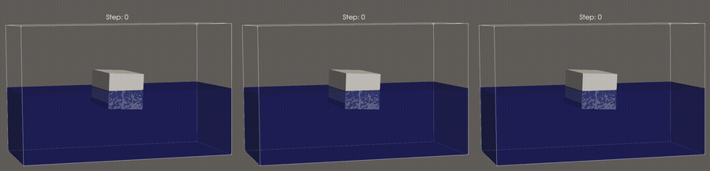
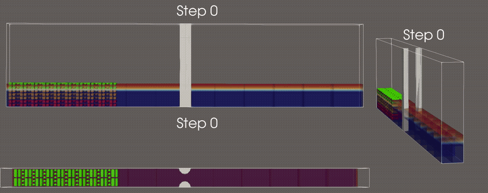
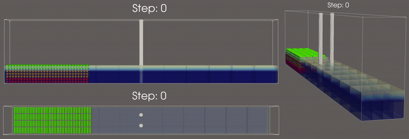

# Numerical Simulation of Floating Debris Transport and Clogging

**Master's Thesis — Dennys Huber, Friedrich-Alexander-Universität Erlangen-Nürnberg, Lehrstuhl für Informatik 10 (Systemsimulation)**
Supervisor: Prof. Dr.-Ing. Harald Köstler · Advisor: M.Sc. Behzad Safaei

Floating debris that accumulates at bridge piers during floods raises the upstream water level and can cause a bridge to fail. This thesis tests whether a particle-resolved simulation — one that resolves every floater and the flow around it — can reproduce how such a jam forms from the interactions of the floaters with each other and with the flow. It builds on a coupled simulation in the **waLBerla** framework that combines a free-surface lattice Boltzmann method (FSLBM) with the discrete element method (DEM) and a momentum exchange method (MEM), extending it from fully submerged spheres to floating cylinders and cuboids, fixed pillars, and a measurement of the clog in the simulated flow. The headline results compare two synthetic obstruction layouts at the same scale — a **centred pillar** (a single-body geometric blockage) and a **hopper gap** (a narrow opening that drifting rods jam by themselves through multi-body interlocking) — plus a two-pillar layout where the rods form only a porous, non-jamming accumulation. The clogging results are purely numerical methodology demonstrations; they are not yet validated against flume experiments and do not predict the clogging of any particular real bridge.

<p align="center">
  
</p>
<p align="center"><em>Figure 1 — Cuboid floating equilibrium at density ratios 0.25, 0.50 and 0.75 (left to right), released at the nominal water level and settling to the analytical draft; the cuboid rolls to its stable heel since upright is unstable at all three ratios.</em></p>

<p align="center">
  
</p>
<p align="center"><em>Figure 2 — A mixture of rods, cuboids and spheres jams the hopper gap.</em></p>

<p align="center">
  
</p>
<p align="center"><em>Figure 3 — The two-pillar layout: 812 rods form only a porous, non-jamming accumulation rather than a clog.</em></p>

More clips (per-shape equilibrium demos, the 406-rod/406-cuboid hopper-gap jams), as both GIFs
and the original full-quality MP4s, are in
[`apps/showcases/Antidunes/docs/clogging-animations/`](apps/showcases/Antidunes/docs/clogging-animations/).

## Thesis implementation

The thesis implementation lives in [`apps/showcases/Antidunes/`](apps/showcases/Antidunes/) — a waLBerla showcase that couples FSLBM (two-phase free-surface flow), DEM (granular particle dynamics) and MEM (fluid-particle momentum exchange) to simulate antidune bedforms and, for this thesis, floating-debris clogging at bridge-pier-like obstructions. See that directory's own [`CLAUDE.md`](apps/showcases/Antidunes/CLAUDE.md) for the full architecture notes, key source files and per-timestep execution order.

Build (from the waLBerla repo root; requires C++20, CMake ≥ 3.26, MPI, and Python ≥ 3.10 with `pystencils`/`lbmpy`/`jinja2` for LBM kernel code generation):

```bash
python -m venv .venv && source .venv/bin/activate
pip install "pystencils~=1.3" "lbmpy~=1.3" jinja2

cmake -G Ninja \
  -DWALBERLA_BUILD_WITH_CODEGEN=ON \
  -DWALBERLA_BUILD_SHOWCASES=ON \
  -DWALBERLA_BUILD_WITH_MPI=ON \
  -DPython_ROOT_DIR="$(pwd)/.venv/bin" \
  -B build/ .

cmake --build build/ --target Antidunes
cmake --build build/ --target BedGeneration
```

Full run instructions (MPI process-count constraints, the two-stage bed-generation → main-simulation workflow, experiment configurations E1–E4) are documented in the showcase's `CLAUDE.md`.

## Key References

Selected by actual weight in the thesis (citation count in the submitted text, in
parentheses), not just topical relevance — see `bibliography/sources.bib` in the
`overleaf` repo for the full ~100-entry list.

- Krüger, T., Kusumaatmaja, H., Kuzmin, A., Shardt, O., Silva, G., & Viggen, E. M. (2017). *The Lattice Boltzmann Method: Principles and Practice*. Springer. https://doi.org/10.1007/978-3-319-44649-3 — the standard LBM reference underlying the fluid solver (34 citations).
- Bogner, S. (2017). *Direct Numerical Simulation of Liquid-Gas-Solid Flows Based on the Lattice Boltzmann Method* (Doctoral dissertation, Friedrich-Alexander-Universität Erlangen-Nürnberg). https://www10.cs.fau.de/publications/dissertations/Diss_2017-Bogner.pdf — the momentum-exchange buoyancy method and floating-body test cases this thesis's equilibrium validation directly follows (41 citations, the single most-cited source).
- Rettinger, C. (2023). *Fully Resolved Simulation of Particulate Flows with a Parallel Coupled Lattice Boltzmann and Discrete Element Method* (Doctoral dissertation, Friedrich-Alexander-Universität Erlangen-Nürnberg). https://open.fau.de/handle/openfau/22561 — the coupled LBM-DEM framework in waLBerla that this thesis's implementation builds on (24 citations).
- Schwarzmeier, C., Rettinger, C., Kemmler, S., Plewinski, J., Núñez-González, F., Köstler, H., Rüde, U., & Vowinckel, B. (2023). *Particle-resolved simulation of antidunes in free-surface flows*. Journal of Fluid Mechanics, 961, R1. https://doi.org/10.1017/jfm.2023.262 — the Antidunes showcase this thesis extends from fully submerged spheres to floating cylinders, cuboids and clogging (11 citations).
- Kodam, M., Bharadwaj, R., Curtis, J., Hancock, B., & Wassgren, C. (2010). *Cylindrical object contact detection for use in discrete element method simulations. Part I — Contact detection algorithms*. Chemical Engineering Science, 65(22), 5852–5862. https://doi.org/10.1016/j.ces.2010.08.006 — the cylinder contact-detection scenarios implemented and benchmarked against (35 citations).
- Kodam, M., Bharadwaj, R., Curtis, J., Hancock, B., & Wassgren, C. (2010). *Cylindrical object contact detection for use in discrete element method simulations, Part II — Experimental validation*. Chemical Engineering Science, 65(22), 5863–5871. https://doi.org/10.1016/j.ces.2010.08.007 — their cylinder-wall impact experiment is replicated directly as this thesis's contact-detection validation test (59 checks against their reported values; 9 citations).
- Guo, Y., Wassgren, C., Ketterhagen, W., Hancock, B., & Curtis, J. (2012). *Some computational considerations associated with discrete element modeling of cylindrical particles*. Powder Technology, 228, 193–198. https://doi.org/10.1016/j.powtec.2012.05.015 — corrections to Kodam's scenario classification, used for the cylinder contact special cases (21 citations).
- Watanabe, S., Kawahara, J., Aoki, T., Sugihara, K., Takase, S., Moriguchi, S., & Hashimoto, H. (2023). *Free-surface flow simulations with floating objects using lattice Boltzmann method*. Engineering Applications of Computational Fluid Mechanics, 17(1), 2211143. https://doi.org/10.1080/19942060.2023.2211143 — closest related coupling (free-surface cumulant LBM + DEM for floating bodies, validated against their own tsunami-flume experiments); this thesis follows their hydrodynamic force/torque averaging and is compared against their approach in the related-work discussion (6 citations).
- Erpicum, S., Poppema, D., Burghardt, L., Benet, L., Wüthrich, D., Klopries, E.-M., & Dewals, B. (2024). *A dataset of floating debris accumulation at bridges after July 2021 flood in Germany and Belgium*. Scientific Data, 11, 1092. https://doi.org/10.1038/s41597-024-03907-8 — real-world motivation for the clogging layouts studied (8 citations).

---

# waLBerla

waLBerla (widely applicable Lattice Boltzmann from Erlangen) is a massively parallel framework for multiphysics simulation applications.
Beyond computational fluid dynamics with the lattice Boltzmann method, the framework now features multiphase and free-surface flows,
rigid body and particle dynamics as well as fluid-structure coupling with moving geometries.
It scales from laptops to current and future supercomputers while maintaining
near-perfect efficiency.

## Getting Started with waLBerla

Refer to our [Setup Guide](https://walberla.pages.i10git.cs.fau.de/walberla/setup-instructions.html) for instructions
on setting up and building waLBerla.

## Documentation and Tutorials

You can find our framework documentation, guides, tutorials, and examples on the following pages:

- Latest Release: [C++ Framework](http://walberla.net/doxygen/index.html), [Python Interface](http://walberla.net/sphinx/index.html)
- Current Development Revision: [C++ Framework](walberla.pages.i10git.cs.fau.de/walberla/)

## Get involved

### Contributing

Please refer to the [contribution guide](CONTRIBUTING.md) for guidance on contributing to waLBerla.

### Support

To get in touch with the waLBerla developers, use our [Issue Tracker](https://i10git.cs.fau.de/walberla/walberla/issues)
or the waLBerla mailing list ([cs10-walberla@fau.de](mailto:cs10-walberla@fau.de)).

## Authors

Many thanks go to waLBerla's [contributors](AUTHORS.txt)

### Please cite us

If you use waLBerla in a publication, please cite the following articles:

Overview:

- M. Bauer et al., _waLBerla: A block-structured high-performance framework for
  multiphysics simulations_. Computers & Mathematics with Applications, 2020.
  https://doi.org/10.1016/j.camwa.2020.01.007.

Grid Refinement:

- F. Schornbaum and U. Rüde, _Massively parallel algorithms for the lattice Boltzmann
  method on nonuniform grids_. SIAM Journal on Scientific Computing, 2016.
  https://doi.org/10.1137/15M1035240

LBM - Particle Coupling:

- C. Rettinger and U. Rüde, _A comparative study of fluid-particle coupling methods for
  fully resolved lattice Boltzmann simulations_. Computers & Fluids, 2017.
  https://doi.org/10.1016/j.compfluid.2017.05.033

Free-surface LBM:

- C. Schwarzmeier et al., _Comparison of free-surface and conservative Allen-Cahn phase-field
  lattice Boltzmann method_. Journal of Computational Physics, 2023.
  https://doi.org/10.1016/j.jcp.2022.111753

Allen-Cahn phase-field LBM

- M. Holzer et al., _Highly efficient lattice Boltzmann multiphase simulations of immiscible
  fluids at high-density ratios on CPUs and GPUs through code generation_. The International Journal of High Performance Computing Applications, 2021.
  https://doi.org/10.1177/10943420211016525

MESA-PD:

- S. Eibl and U. Rüde, _A Modular and Extensible Software Architecture for Particle Dynamics_.
  Proceedings of the 8th International Conference on Discrete Element Methods.
  https://doi.org/10.48550/arXiv.1906.10963

Carbon Nanotubes:

- G. Drozdov et al., _Densification of single-walled carbon nanotube films:
  Mesoscopic distinct element method simulations and experimental validation_.
  Journal of Applied Physics, 2020. https://doi.org/10.1063/5.0025505

## License

waLBerla is licensed under [GPLv3](COPYING.txt).
