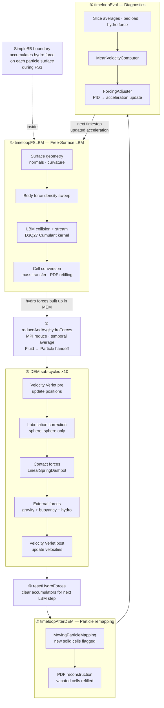
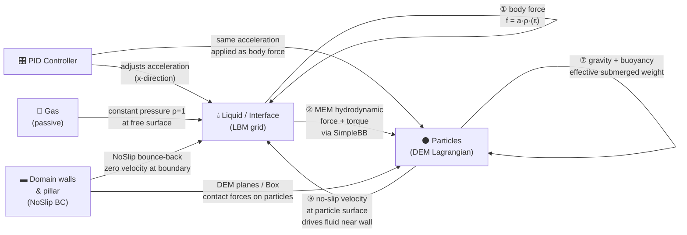
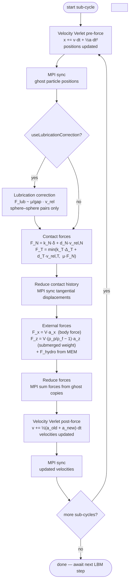

# Forces in the Antidunes Simulation

The simulation computes forces in two separate systems that exchange information once per timestep: the **LBM fluid** (Eulerian, grid-based) and the **DEM particles** (Lagrangian, per-particle). The sections below follow the order in which forces are applied each timestep.

---

## High-Level Diagrams

### Timestep Coupling Loop

Each timestep runs three time loops sequentially, with explicit DEM sub-cycling in between. The arrows show where force information crosses from one system to the other.



---

### Force Exchange Between Phases

Which forces act on which material, and where they come from.



---

### DEM Sub-Cycle Force Stack

Each of the 10 sub-cycles per LBM step applies forces in this exact order (`ParticleKernels.h:206–267`). Forces accumulate additively before the post-force velocity update.



---

## 1. Body Force on the Fluid

**Where:** `ForceDensityCodegenSweep::operator()` — `Forcing.h:52–75`  
**When:** every LBM timestep, before collision and streaming

The global acceleration vector `acceleration` (shared pointer, updated by PID) is converted to a per-cell force density:

```
liquid cell:    f = acceleration × ρ
interface cell: f = acceleration × ρ × ε
```

where ρ is the local LBM density and ε ∈ [0,1] is the fill level. The fill-level scaling on interface cells ensures only the liquid fraction of the cell is driven — gas carries no force.

**Why it exists:** the domain is periodic in x, so there is no inlet pressure difference to drive the flow. The body force substitutes for the pressure gradient that would exist in a real open-channel flow. The x-component is continuously adjusted by the PID controller (see §6) to maintain the target Reynolds number.

**Parameters:** `acceleration[0]` (x, PID-controlled), `acceleration[2] = -gravity` (z, constant).

---

## 2. Hydrodynamic Force on Particles (Momentum Exchange Method)

**Where:** `SimpleBB` boundary (`lbm_mesapd_coupling/momentum_exchange_method/boundary/SimpleBB.h`) — executed inside `timeloopFSLBM->singleStep()`  
**When:** during each LBM stream step, at every fluid cell adjacent to a particle surface

When the LBM streams a PDF from a fluid cell into a cell flagged `MovingObstacle`, the bounce-back rule reflects the distribution back. The momentum change of the reflected PDF — corrected for the particle's own surface velocity — is accumulated as a force and torque on the particle:

```
ΔF = 2 × f_i(x, t) × e_i  +  2 × ρ_wall × (e_i · u_particle) × e_i
```

where `e_i` is the lattice velocity vector and `u_particle` is the DEM velocity of the particle at the surface point.

**Why it exists:** this is the coupling from fluid to particle — it captures drag, pressure, and lift from the resolved fluid velocity field. The force from a full LBM timestep is the net momentum transferred from all surface cells.

**Code path:**
1. Force accumulated during `timeloopFSLBM->singleStep()` into `hydroForce` per particle.
2. MPI-reduced and time-averaged in `particleKernels.reduceAndAvgHydroForces()` (`ParticleKernels.h:186–203`).
3. Passed to DEM via `AddExternalForces` (§4).
4. Reset after DEM in `particleKernels.resetHydroForces()` (`ParticleKernels.h:177–183`).

---

## 3. Contact Normal Force

**Where:** `LinearSpringDashpot` kernel inside `ComputeContacts::operator()` — `ParticleKernels.h:97–120`  
**When:** every DEM sub-cycle, for every overlapping particle pair

A linear spring-dashpot model in the normal direction:

```
F_N = k_N × δ  +  d_N × v_rel,N
```

- `δ` = overlap (penetration depth, positive when particles touch)
- `v_rel,N` = relative velocity projected onto the contact normal
- `k_N`, `d_N` = normal stiffness and damping, derived from `restitutionCoefficient` and `collisionTime`:

```
k_N = m_eff × (π² + ln²(e)) / t_c²
d_N = -2 × m_eff × ln(e) / t_c
```

where `e` is `restitutionCoefficient` (0.97) and `t_c` is `collisionTime` (= 4 × avgDiameter in lattice units). These are set in `ComputeContacts` constructor (`ParticleKernels.h:83–120`) via `setStiffnessAndDamping()`.

**Why it exists:** prevents particles from passing through each other. The spring provides a restoring force proportional to overlap; the dashpot dissipates kinetic energy during collision, mimicking inelastic impacts controlled by the restitution coefficient.

---

## 4. Contact Tangential Force and Friction

**Where:** `LinearSpringDashpot` kernel — same call as §3  
**When:** every DEM sub-cycle, for every overlapping particle pair with relative tangential motion

A spring-dashpot in the tangential direction, capped by Coulomb's friction law:

```
F_T,spring = k_T × Δ_T  +  d_T × v_rel,T
F_T = min(|F_T,spring|, μ_dyn × |F_N|) × t̂
```

- `Δ_T` = accumulated tangential spring displacement (stored in contact history between sub-cycles)
- `v_rel,T` = relative velocity in the tangential plane
- `k_T = κ × k_N`, `d_T = √κ × d_N`, where `κ` (kappa) = `2(1-ν)/(2-ν)` ≈ 0.826 for Poisson ratio ν = 0.22
- `μ_dyn` = `frictionCoefficient` (0.5)

The contact history is preserved across sub-cycles via `ReduceContactHistory` (MPI sync of the tangential displacement vector).

**Why it exists:** rolling resistance and static friction between particles — without it all contacts would be frictionless and particles would slide rather than roll. The Coulomb cap switches from sticking to sliding when the tangential force would exceed `μ × F_N`.

---

## 5. Lubrication Correction Force

**Where:** `LubricationCorrectionKernel` inside `ComputeLubrication::operator()` — `ParticleKernels.h:59–70`  
**When:** every DEM sub-cycle, for sphere pairs whose gap is below the cut-off distance (only if `useLubricationCorrection = true`)

When two spheres approach each other, the fluid film between them resists being squeezed out. The LBM cannot resolve this sub-cell gap accurately, so a correction is added analytically. Three components act simultaneously:

**Normal squeeze (dominant):**
```
F_lub,N = 6π × r₁ × μ × [κ² / (1+κ)²] × (1/ε - 1/ε_res) × (u_rel · ê) × ê
```

**Tangential translation:**
```
F_lub,T = 6π × r₁ × μ × [...] × ln(ε/ε_res) × (u_rel - (u_rel·ê)ê)
```

**Tangential rotation:**
```
F_lub,rot = 6π × r₁² × μ × [...] × ln(ε/ε_res) × (ω₁ + ω₂) × ê
```

where:
- `ε = gap / r₁` (dimensionless gap)
- `ε_res = cutoff / r₁` (resolution limit — gap below which the LBM is no longer trusted)
- `κ = r₂ / r₁` (radius ratio)
- `μ` = dynamic fluid viscosity
- `ê` = unit vector from sphere 1 to sphere 2

The cut-off distance and minimum gap function are set in `ComputeLubrication` constructor (`ParticleKernels.h:53–57`): `minGap(r) = (0.001 + 0.00007×r) × r`.

**Why it exists:** gaps smaller than ~1 cell cannot be resolved by the LBM stream-collide algorithm. Without this correction, particles approaching very close would experience artificially low lubrication force and collide too hard. The correction is the difference between the analytical Stokes solution and what the LBM already captures.

**Only sphere–sphere:** the guard in `ComputeLubrication::operator()` (`ParticleKernels.h:62–63`) skips any pair where either particle is not a sphere — the formula above is only derived for two spheres.

---

## 6. Gravity and Buoyancy on Particles

**Where:** `AddExternalForces::operator()` — `ParticleKernels.h:134–146`  
**When:** every DEM sub-cycle, for every local particle

```
F_x = volume × acceleration[0]          (same driving force as fluid)
F_y = volume × acceleration[1]          (zero in default config)
F_z = volume × (densityRatio - 1) × acceleration[2]
```

The x/y components apply the same body acceleration to the particle as to the fluid, so a neutrally buoyant particle (densityRatio = 1) would follow the flow with no net force. In z, only the **submerged weight** is applied: `(ρ_p/ρ_f - 1) × g × V` — the full gravity minus the buoyancy force.

**Why `(densityRatio - 1)` in z only:** the `SimpleBB` MEM boundary already transfers the hydrostatic pressure force to the particle in z. Applying `densityRatio × g` would double-count buoyancy in the vertical direction. In x/y there is no hydrostatic contribution, so the full acceleration is applied.

**Parameters:** `densityRatio = 2.55` (quartz sand in water), `acceleration[2] = -gravity` (computed from Fr).

---

## 7. PID Flow-Rate Control

**Where:** `ForcingAdjuster::operator()` + `PIDController::update()` — `Forcing.h:176–222`, `PIDController.h/.cpp`  
**When:** every `evaluationFrequency` timesteps (default: every 1000 steps)

This is not a physical force on particles but a control law that adjusts `acceleration[0]` — the x-body-force applied to the fluid (§1) and particles (§6):

```
error(t)     = targetMeanVelocity - |meanVelocity(t)|
acceleration[0](t) = P × error + I × ∫error dt + D × Δerror/Δt
```

The mean velocity is computed in `MeanVelocityComputer` (`Forcing.h:121–159`) by summing `pdfField->getVelocity()` over all liquid and interface cells and MPI-reducing.

**Why it exists:** a real open-channel experiment runs at fixed flow rate. The body-force equivalent of the pressure gradient must be continuously re-tuned as the bedform evolves and changes the flow resistance. Without PID, the mean velocity would drift away from the target Re as antidunes grow.

**Parameters:** `proportionalGain = 2e-4`, `derivativeGain = 1e-6`, `integralGain = 2e-4`, `maxRamp = 1e-4`.

---

## Force Summary

| Force | Acts on | Computed by | Every |
|---|---|---|---|
| Body force (fluid) | All liquid/interface cells | `ForceDensityCodegenSweep` | LBM step |
| Hydrodynamic (MEM) | Each particle surface | `SimpleBB` bounce-back | LBM step |
| Contact normal | Overlapping particle pairs | `LinearSpringDashpot` | DEM sub-cycle |
| Contact tangential + friction | Overlapping particle pairs | `LinearSpringDashpot` | DEM sub-cycle |
| Lubrication correction | Near-contact sphere pairs | `LubricationCorrectionKernel` | DEM sub-cycle |
| Gravity + buoyancy | Each particle | `AddExternalForces` | DEM sub-cycle |
| PID acceleration update | `acceleration[0]` (fluid + particles) | `PIDController` | 1000 steps |
